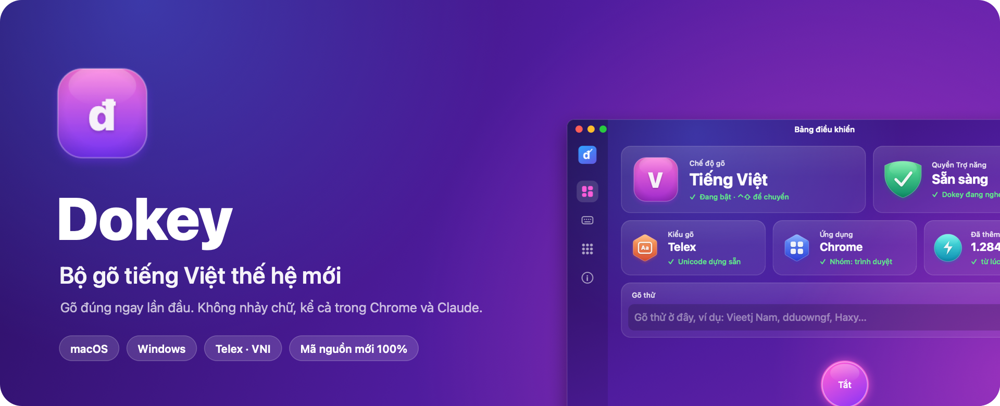
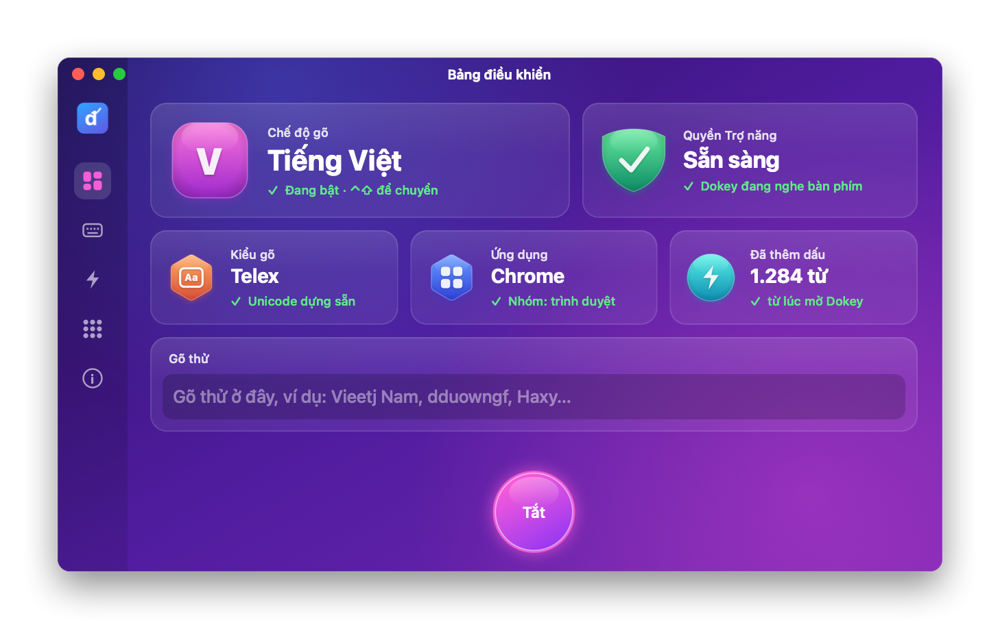
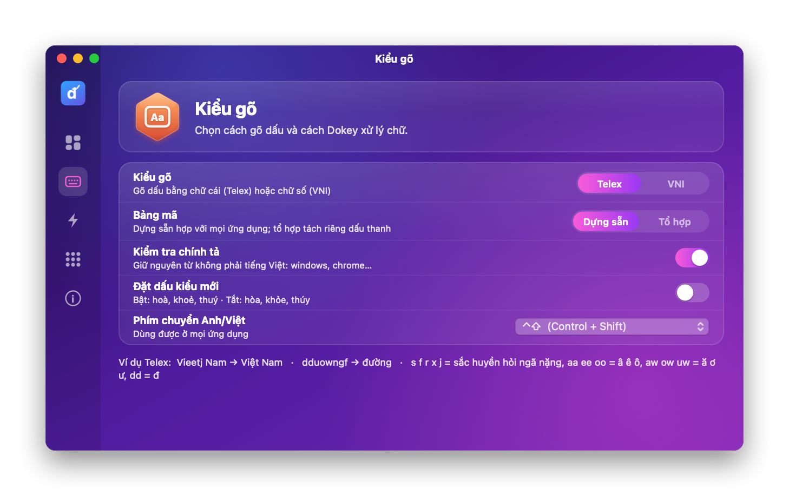
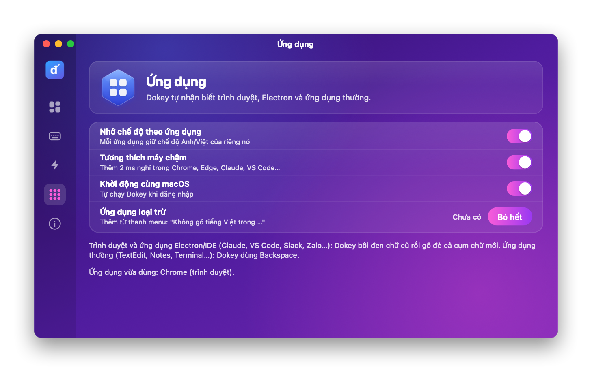
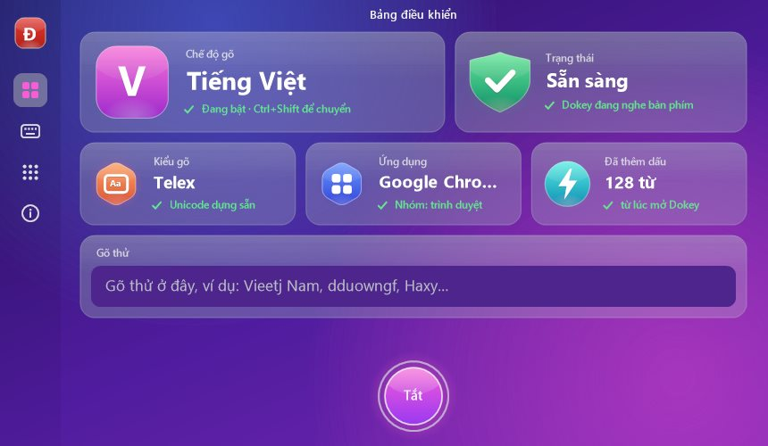
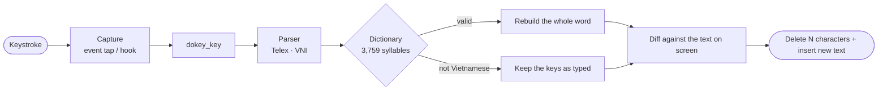

<div align="center">



<br>

[](https://github.com/dhtoan/Dokey/actions/workflows/ci.yml)
[](https://github.com/dhtoan/Dokey/releases/latest)


[](https://doi.org/10.5281/zenodo.23888629)


[](LICENSE)
[](#-support-dokey)

# Dokey: Vietnamese input method for Mac and Windows

### Right the first time. No jumbled or lost letters, in every app.

[](README.md)
[](README.en.md)
[](README.ko.md)

[**⬇️ Get it for macOS**](#-macos) &nbsp;·&nbsp; [**⬇️ Get it for Windows**](#-windows) &nbsp;·&nbsp; [Features](#-features) &nbsp;·&nbsp; [Developers](#-for-developers) &nbsp;·&nbsp; [Roadmap](#-roadmap)

</div>

---

**Dokey** is a free Vietnamese input method (keyboard) for **macOS** (Intel and Apple Silicon) and **Windows 10/11**, supporting **Telex** and **VNI**, rewritten from scratch. On every keystroke it rebuilds the whole word and checks it against a dictionary of 3,759 syllables, so what you see on screen always matches what you typed. No jumbled letters, no lost letters, even in Chrome, Edge, Claude or Electron apps.

<div align="center">

</div>

## 💡 Why Dokey?

Typing Vietnamese on a computer still runs into annoying bugs: letters jumping around in Chrome, letters lost in the chat box of Electron apps, English words getting accents, and the text on screen drifting away from what the input method thinks it typed. Dokey was written from zero to fix these at the root:

| Common problem | How Dokey solves it |
|---|---|
| Jumbled or doubled letters when typing fast | Correction keys are inserted right at the tap position, always ahead of the next key you type |
| Lost letters in Claude, Notion, browser address bars | Selects the old letters and types the whole replacement over them, never with the code of a key that is still held |
| Screen and input method out of sync | Each keystroke rebuilds the whole word from the keys typed, with a pure function |
| English words get accents (`windows` → wíndows) | Checked against the 3,759-syllable dictionary; if it is not Vietnamese, the keys stay as typed |
| macOS warns at install | One-line install script, no warning |

## ✨ Features

<table>
<tr>
<td width="50%" valign="top">

**⚡ No jumbled or lost letters**<br>
Keys are only sent when a word really has to change. In browsers and Electron apps, Dokey selects the old letters and types over them in one go, so fast typing stays correct.

</td>
<td width="50%" valign="top">

**📖 Understands Vietnamese spelling**<br>
Marks are only added when the result is valid Vietnamese. English words like `windows`, `chrome`, `github` stay as typed.

</td>
</tr>
<tr>
<td valign="top">

**✍️ Free mark placement**<br>
`tieengs`, `tienges`, `tiengse` all give **tiếng**; `dduocwj` and `dduowcj` both give **được**. Repeat a mark key to undo it (`aaa` → aa).

</td>
<td valign="top">

**🎯 Correct tone placement**<br>
Modern style (hoà, khoẻ, thuý) or traditional (hòa, khỏe, thúy). Telex, VNI, precomposed and combining Unicode.

</td>
</tr>
<tr>
<td valign="top">

**🧠 Remembers each app**<br>
Every app keeps its own Vietnamese/English mode, and apps can be excluded. Switch with ⌃⇧ on Mac, Ctrl+Shift on Windows.

</td>
<td valign="top">

**🪶 Light and private**<br>
A C++17 core with no external dependencies. Nothing is sent anywhere, keystrokes are never recorded.

</td>
</tr>
<tr>
<td valign="top">

**⚡ Quick typing**<br>
Text shortcuts (`vn` → Việt Nam), Quick Telex (`cc` → ch, `nn` → ng), undo with Esc (`tiếng` → tieesng).

</td>
<td valign="top">

**↩️ Easy corrections**<br>
After a word and a space, press Backspace to go back and fix its marks. Deleting a final consonant moves the tone back where it belongs.

</td>
</tr>
</table>

| Method | Examples |
|---|---|
| **Telex** | `dduowngf` → đường · `nguoiwf` → người · `Haxy` → Hãy · `quyeets` → quyết · `DDawks Lawks` → Đắk Lắk |
| **VNI** | `d9u7o7ng2` → đường · `Vie65t` → Việt |

## 🍎 macOS

<table>
<tr>
<td width="50%"></td>
<td width="50%"></td>
</tr>
</table>

**Install.** Open Terminal and run the command below. It downloads the latest release, installs it into Applications and avoids the macOS warning:

```bash
gh release download -R dhtoan/Dokey --pattern install-macos.sh --dir /tmp --clobber && bash /tmp/install-macos.sh
```

Then enable Dokey in **System Settings › Privacy & Security › Accessibility**. You can also download `Dokey-<version>.dmg` from [Releases](https://github.com/dhtoan/Dokey/releases/latest).

- One Universal binary: Intel from macOS 10.13, Apple Silicon from macOS 11.
- **Korean typing (2-beolsik, beta):** menu bar › Typing language › 한국어. The interface switches to Korean on a Korean Mac. See [README.ko.md](README.ko.md).
- A **V/E** icon in the menu bar. Open Dokey.app to get the control panel, with a **Try typing** box (“Gõ thử”) built in.
- Detects browsers, Electron/IDE apps and regular apps and picks the right way to send keys for each. A **slow-Mac mode** (“Tương thích máy chậm”) is available.
- Builds with the Command Line Tools only, no Xcode: `apps/macos/build.sh --dmg`.

<details>
<summary><b>Updating and uninstalling</b></summary>

**Update:** run the install command again, then grant Accessibility again (remove Dokey from the list and add it back). Each release has its own signature, so macOS treats it as a new app.

**Uninstall:**

```bash
osascript -e 'tell application id "com.dhtoan.dokey.mac" to quit'
rm -rf /Applications/Dokey.app
defaults delete com.dhtoan.dokey.mac
rm -f ~/Library/LaunchAgents/com.dhtoan.dokey.mac.launcher.plist ~/Library/Logs/Dokey*.log
```

Then remove Dokey from **System Settings › Privacy & Security › Accessibility**.

</details>

Details: [apps/macos/README.md](apps/macos/README.md) (Vietnamese) · What has been tested: [docs/TESTING.md](docs/TESTING.md) (Vietnamese).

## 🪟 Windows

<div align="center">

</div>

The same interface on Windows 10/11, drawn with GDI+. Download `Dokey-<version>-Windows-Setup.exe` from [Releases](https://github.com/dhtoan/Dokey/releases/latest).

<details>
<summary><b>Dokey for Windows 10/11</b>: one installer, <code>Dokey-&lt;version&gt;-Windows-Setup.exe</code>, for x86, x64 and ARM64</summary>

> ⚠️ **Not yet tried on a real Windows PC.** Dokey for Windows was written on macOS. All tests below run on GitHub Actions virtual machines (Windows Server 2022, x64). The x86 and ARM64 builds have only been compiled, never run.

- A **V/E** icon in the system tray; switch Vietnamese/English with Ctrl+Shift or Alt+Z, or by clicking the icon.
- Telex/VNI, spell checking, modern/traditional tone placement, start with Windows.
- **No jumbled letters:** a light `WH_KEYBOARD_LL` hook on its own thread; each correction is a single `SendInput` call (delete + insert Unicode); keys typed meanwhile queue behind Dokey's text and cannot overtake it. Chrome, Edge and Electron apps (`Chrome_WidgetWin_*`) get a short pause between the delete and the new text.
- Steps aside while a Chinese/Japanese/Korean IME is active; starts a new word on mouse clicks, window changes and arrow keys.
- No administrator rights, no Visual C++ Redistributable needed.

| Item | Status |
|---|---|
| Build `Dokey.exe` for x86, x64, ARM64 (MSVC, static CRT) and check each file's architecture | ✅ Every CI run |
| Unit tests: `SendInput` event sequences, `dwExtraInfo` tagging, engine contract | ✅ CI, x64 and x86 |
| `Dokey.exe --self-test`: install and remove the keyboard/mouse hooks | ✅ CI, x64 and x86 |
| **Real typing into Notepad**: simulated keys via `SendInput`, normal (40 ms/key) and full speed, text read back from Notepad: `Việt Nam đường windows Tôi yêu tiếng Việt` | ✅ CI, x64 (VM) |
| Installer: silent install, picks the x64 build, Start menu shortcut, clean uninstall | ✅ CI, x64 (VM) |
| Typing in Chrome, Edge, VS Code, Word… | ❌ Not tested |
| Real Windows 10/11 PCs, slow machines, ARM64 devices, x86 on 32-bit Windows | ❌ Not tested |
| Tray UI, menu, switch shortcuts, start with Windows | ❌ Not tested by hand |

The installer is not code-signed, so SmartScreen may warn: choose **More info → Run anyway**. Details: [apps/windows/README.md](apps/windows/README.md).

</details>

## ❓ FAQ

<details>
<summary><b>What is a good Vietnamese keyboard for Mac?</b></summary>

Dokey is a free Vietnamese input method for macOS 10.13 and later, on Intel and Apple Silicon. It supports Telex and VNI, spell checking, keeps English words as typed, and is built to avoid jumbled letters in Chrome, Edge, Safari, ChatGPT, Claude, Notion and VS Code.

</details>

<details>
<summary><b>Why does Vietnamese typing jumble letters in Chrome?</b></summary>

Chrome and Electron apps handle keys in a separate process, so the delete keys and the new text can arrive out of order or be dropped. Dokey inserts corrections right at the capture point, selects the old letters and types the whole replacement in one go, and never uses the code of a key that is still held.

</details>

<details>
<summary><b>Is Dokey free? Does it use Unikey or OpenKey code?</b></summary>

Dokey is free for personal use, with no ads and no paid tier. It is written entirely from scratch around its own C++17 engine, Dokey Core, and contains no code from any other input method.

</details>

<details>
<summary><b>Installed, but no accents appear?</b></summary>

Dokey needs **Accessibility** permission. Open **System Settings › Privacy & Security › Accessibility**, remove Dokey (−), add `/Applications/Dokey.app` back (+) and switch it on. Repeat after every update. The **Accessibility** card (“Quyền Trợ năng”) in the control panel shows whether Dokey is ready.

</details>

<details>
<summary><b>No accents in password fields or in Terminal with "Secure Keyboard Entry"?</b></summary>

When an app turns on Secure Input (password fields, Terminal's Secure Keyboard Entry), macOS stops every input method from reading keys. That is an operating-system security feature.

</details>

<details>
<summary><b>Fast typing on an old Mac still goes wrong sometimes?</b></summary>

Open the control panel, go to **Apps** (“Ứng dụng”) and turn on **slow-Mac mode** (“Tương thích máy chậm”). If it still happens, report the app name and the keys typed (for example `Haxy` → `Hy`).

</details>

<details>
<summary><b>Turn Vietnamese off for one app?</b></summary>

Keep **Remember mode per app** (“Nhớ chế độ theo ứng dụng”) on (the default), open that app and press ⌃⇧ to switch to English. Next time that app opens in English mode.

</details>

## 🔒 Privacy

Dokey runs entirely on your machine. It makes no network connections, collects no data and never stores keystrokes. The debug log is off by default; only if you turn it on does Dokey write to `~/Library/Logs/Dokey.log` on your machine.

## 🛠 For developers

Dokey Core is a self-contained C++17 library with a stable C API for Swift, Win32 or Kotlin.

```console
$ dokey "Xin chaof cacs banj, Dokey gox tieengs Vieetj khoong nhayr chuwx."
Xin chào các bạn, Dokey gõ tiếng Việt không nhảy chữ.
```

<details>
<summary><b>Command-line tool, building and the C API</b></summary>

```bash
dokey "Vieetj Nam"                 # Việt Nam
echo "chaof buooir sangs" | dokey  # chào buổi sáng
dokey --vni "Vie65t Nam"           # Việt Nam
dokey --old-tone "hoaf binhf"      # hòa bình
```

Build from source (CMake 3.16+, a C++17 compiler):

```bash
cmake -S . -B build -DCMAKE_BUILD_TYPE=Release
cmake --build build --config Release
ctest --test-dir build -C Release
```

Integration: pass each key to the engine, then apply the edit it returns.

```c
#include <dokey/dokey.h>

dokey_options opt = { DOKEY_TELEX, DOKEY_UNICODE, /*modern*/ 1, /*spell*/ 1 };
dokey_engine* engine = dokey_create(&opt);

dokey_edit edit;
if (dokey_key(engine, typedChar, &edit)) {
    // Swallow the key, delete edit.backspaces characters, insert edit.text (UTF-16).
} else {
    // Let the original key through.
}
dokey_backspace(engine);  // the user pressed Backspace
dokey_reset(engine);      // mouse click, app switch, arrow keys
dokey_destroy(engine);
```

</details>

### Architecture



```
Dokey/
├── include/dokey/        Public API: dokey.h (C), engine.hpp (C++)
├── src/                  Core: Telex/VNI parser, tone placement, syllable dictionary, Unicode
├── tools/                dokey command-line tool
├── tests/                20,635 core test cases, real-word data in tests/data
├── apps/
│   ├── macos/            Swift + AppKit: event tap, control panel, build.sh, install.sh
│   └── windows/          C++ Win32 + GDI+: keyboard hook, control panel, Inno Setup installer
├── docs/                 Images, test results
└── .github/              CI, release workflow, release notes
```

**Quality:** 20,635 test cases run on Linux, macOS and Windows after every change:
- a round trip that types all 3,964 syllables with all 6 tones;
- a regression corpus of 1,171 English and developer words (which must stay as typed) and 30 real Vietnamese sentences typed in Telex. The code compiles without warnings under `-Wall -Wextra -Wpedantic`.

## 🗺 Roadmap

| Version | Contents | Status |
|---|---|---|
| **0.1** | Dokey Core: Telex, VNI, spell checking, C/C++ API, command-line tool | ✅ |
| **0.2** | macOS app (Swift + AppKit, Intel and Apple Silicon) | ✅ |
| **0.3** | Windows app; lost-letter fixes for Claude and browsers; new control panel; warning-free install | ✅ |
| **0.4** | Text shortcuts, Quick Telex, undo with Esc, reopen word, excluded apps, Google Docs, Spotlight, update check | ✅ |
| 0.5 | Encoding converter, TCVN3, VNI Windows, CP1258; quick typing on Windows | 🗓️ |
| 1.0 | Code signing and notarization, general release | 🗓️ |

Changes in each version: [Releases](https://github.com/dhtoan/Dokey/releases).

## ☕ Support Dokey

Dokey is **free** for personal use and always will be: no ads, no data collection, no paid tier.

One thing Dokey can't do alone yet is **Apple code signing**. An Apple Developer account costs **99 USD a year**. With it:

- ✅ Open the `.dmg` and install, **no "unidentified developer" warning**, no Terminal command.
- ✅ **No need to grant Accessibility again after every update**: a stable signature means macOS remembers the permission.
- ✅ One-click updates for everyone, no GitHub CLI needed.
- ✅ A path to a Mac App Store version of Dokey.


If Dokey makes your Vietnamese typing a little nicer every day, buy the author a coffee. Every contribution goes to the goal above. Anything left over goes to a Windows code-signing certificate, so the installer no longer triggers SmartScreen warnings.

<table>
<tr>
<td align="center" width="50%">
<br>
<b>Bank transfer</b><br>
Scan with any Vietnamese banking app<br>
Techcombank · App Dokey · note <code>dokey</code>
</td>
<td align="center" width="50%">
<br>
<b>MoMo wallet</b><br>
Scan with MoMo or a banking app<br>
Add the note <code>dokey</code>
</td>
</tr>
</table>

| | |
|---|---|
| 🧋 20,000 ₫ | An iced tea for the person who writes your input method |
| ☕ 50,000 ₫ | A Vietnamese iced coffee, enough to fix one typing bug |
| 🍜 100,000 ₫ | A bowl of phở, enough for a new feature |
| 🍎 99 USD | A whole year of Apple signing for everyone |

Want your name in **Supporters** below? Add it to the transfer note (for example `dokey Minh Anh`). Otherwise you stay anonymous. International options (GitHub Sponsors, Ko-fi) are coming soon.

**Can't sponsor right now?** No problem at all. A ⭐ on the repo, telling a friend, or reporting a typing bug is support too.

### 💛 Supporters

*No one yet. Be the first!*

## 📄 Paper

The design, implementation and test results of Dokey are described in a working paper:

> Do Huy Toan (2026). *Dokey: A Vietnamese Input Method That Rebuilds the Whole Word on Every Keystroke* (Version 2) [Working paper]. Zenodo. https://doi.org/10.5281/zenodo.23888629

PDF: [dhtoan.github.io/papers/dokey-2026](https://dhtoan.github.io/papers/dokey-2026/) · [Zenodo](https://zenodo.org/records/23888629)

## ⚖️ License

Dokey is **proprietary software**. © 2026 Do Huy Toan ([dhtoan](https://github.com/dhtoan)). All rights reserved.

You may install and use official releases for your own use. Copying, modifying, redistributing, decompiling or using the source code to build another product is **prohibited** without the author's written permission. Full text: [LICENSE](LICENSE).

Dokey is written entirely from scratch and contains no code from any other input method.

---

<div align="center">

© 2026 Do Huy Toan (dhtoan). All rights reserved.

</div>
