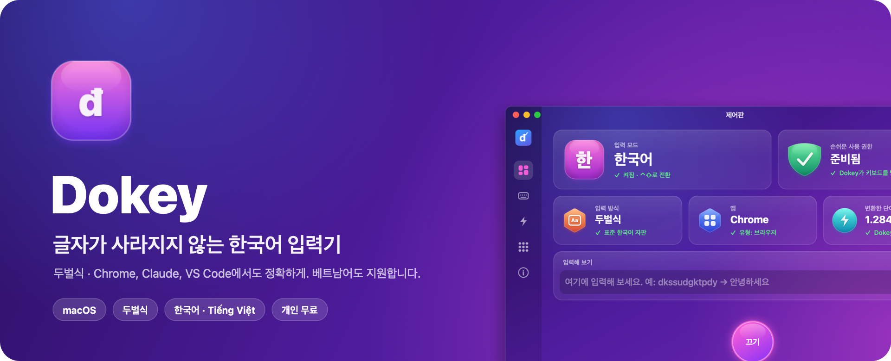
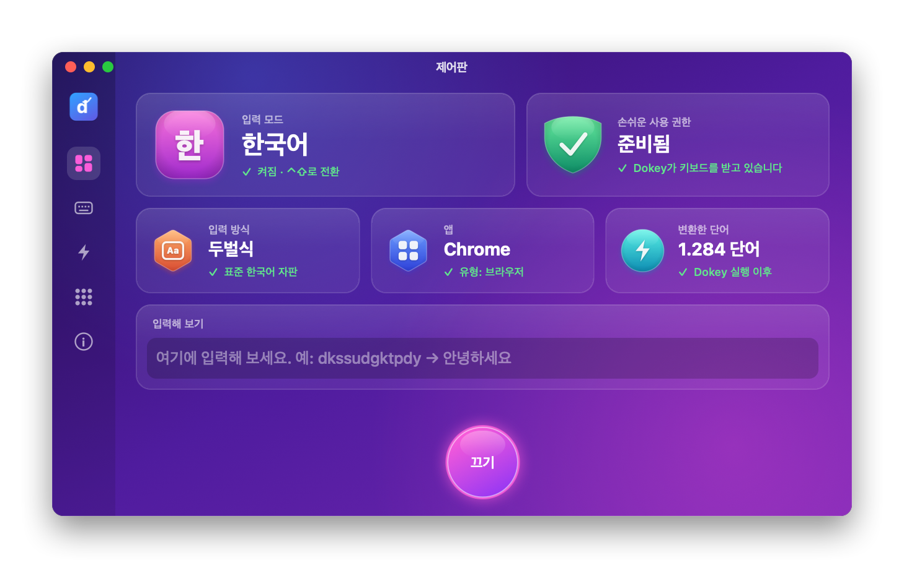

<div align="center">



<br>

[](https://github.com/dhtoan/Dokey/actions/workflows/ci.yml)
[](https://github.com/dhtoan/Dokey/releases/latest)


[](LICENSE)

# Dokey: 글자가 씹히지 않는 맥 한글 입력기

### Chrome, Claude, ChatGPT, Notion에서도 한글이 씹히거나 자모가 분리되지 않게.

[](README.md)
[](README.en.md)
[](README.ko.md)

[**⬇️ 다운로드**](#-설치) &nbsp;·&nbsp; [기능](#-기능) &nbsp;·&nbsp; [자주 묻는 질문](#-자주-묻는-질문) &nbsp;·&nbsp; [웹사이트](https://dhtoan.github.io/Dokey/ko/)

</div>

---

**Dokey**는 macOS용 무료 입력기입니다. 표준 **두벌식**으로 한글을 입력하고, 같은 앱에서 **베트남어**(Telex, VNI)도 입력할 수 있습니다.

키를 누를 때마다 지금 입력 중인 음절을 처음부터 다시 조합하고, 화면에서 바뀐 글자만 그 자리에서 고칩니다. 조합 중 밑줄(마크드 텍스트)을 쓰지 않기 때문에 웹 브라우저와 Electron 앱(Claude, Notion, Slack, VS Code 등)에서도 항상 완성된 글자가 바로 들어갑니다.

> 🧪 **한국어 입력은 베타입니다.** TextEdit, Safari, Microsoft Edge에서 실제 키 입력으로 확인했습니다. 다른 앱에서 문제가 있으면 [Issues](https://github.com/dhtoan/Dokey/issues)로 알려 주세요.

<div align="center">

</div>

## 💡 왜 Dokey인가요?

| 자주 겪는 문제 | Dokey의 해결 방법 |
|---|---|
| 빠르게 입력하면 Chrome에서 글자가 씹힘 | 수정 키를 입력 위치에서 바로 넣어, 다음에 누른 키보다 항상 먼저 처리되게 합니다 |
| Enter를 누르면 마지막 글자가 중복되거나 자모가 분리됨 | 조합 중 밑줄을 쓰지 않고 완성된 글자를 바로 입력하도록 설계했습니다 |
| 키보드 배열(Dvorak 등)에 따라 자모가 달라짐 | 두벌식을 키 위치로 읽어 배열과 관계없이 정확합니다 |
| 입력기가 키를 엿보지 않을까 걱정됨 | 모든 처리는 Mac 안에서만. 네트워크 연결도, 키 입력 기록도 없습니다 |

## ✨ 기능

- **표준 두벌식**: Shift + q w e r t로 쌍자음 ㅃ ㅉ ㄸ ㄲ ㅆ, Shift + o p로 ㅒ ㅖ.
- **자모 단위 Backspace**: 한 → 하 → ㅎ.
- **한/영 전환**: Control + Shift(⌃⇧)를 눌렀다 떼기. 다른 단축키로 바꿀 수 있고, 앱마다 마지막 모드를 기억합니다.
- **입력 언어 전환**: 메뉴 막대 › 입력 언어 › 한국어 / Tiếng Việt, 또는 제어판의 입력 방식 페이지.
- **앱별 처리**: 브라우저와 Electron 앱은 이전 글자를 선택해 덮어쓰고, VS Code의 터미널처럼 선택이 안 되는 곳에서는 Backspace를 씁니다.
- **한국어 인터페이스**: 시스템 언어가 한국어이면 메뉴와 제어판이 한국어로 표시됩니다.
- **제외할 앱, 로그인 시 자동 실행, 업데이트 확인**.

| 입력 | 결과 |
|---|---|
| `dkssudgktpdy` | 안녕하세요 |
| `rkatkgkqslek` | 감사합니다 |
| `gksrnr` | 한국 |
| `rkqtdl dlTdj` | 값이 있어 |

## 📦 설치

1. 터미널에서 다음 명령을 실행합니다. 최신 버전을 내려받아 응용 프로그램 폴더에 설치하며, macOS 경고 없이 열립니다.

   ```bash
   gh release download -R dhtoan/Dokey --pattern install-macos.sh --dir /tmp --clobber && bash /tmp/install-macos.sh
   ```

   [Releases](https://github.com/dhtoan/Dokey/releases/latest)에서 `Dokey-<버전>.dmg`를 직접 내려받아도 됩니다.
2. **시스템 설정 › 개인정보 보호 및 보안 › 손쉬운 사용**에서 Dokey를 켭니다.
3. 메뉴 막대의 Dokey 아이콘 › **입력 언어 › 한국어 (두벌식)** 를 고릅니다. 아이콘이 **한**으로 바뀝니다.
4. macOS 입력 소스는 **ABC**(또는 U.S.)로 둡니다. 기본 2벌식 입력 소스와 함께 켜 두면 두 입력기가 동시에 조합합니다.

- 지원 환경: macOS 10.13 이상, Intel 및 Apple Silicon (유니버설 바이너리).
- Windows용 Dokey는 현재 베트남어를 지원하며, 한국어는 준비 중입니다.

## ❓ 자주 묻는 질문

<details>
<summary><b>맥에서 Chrome이나 Claude를 쓸 때 한글이 씹히는 이유는 무엇인가요?</b></summary>

Chrome과 Electron 앱은 키 입력을 별도 프로세스에서 처리하기 때문에, 입력기가 보낸 수정 키와 새 글자가 어긋나거나 사라질 수 있습니다. Dokey는 수정할 글자만 입력 위치에서 바로 선택해 덮어쓰고, 사용자가 누르고 있는 키의 코드를 쓰지 않아 글자 씹힘을 줄였습니다.

</details>

<details>
<summary><b>Enter를 누르면 마지막 글자가 중복돼요. Dokey도 그런가요?</b></summary>

이 문제는 보통 조합 중인 글자(밑줄 표시)를 앱이 제대로 확정하지 못해 생깁니다. Dokey는 조합 중 밑줄을 쓰지 않고 항상 완성된 글자를 바로 입력하므로, 이런 유형의 문제가 생기지 않도록 설계되었습니다.

</details>

<details>
<summary><b>세벌식도 지원하나요?</b></summary>

아직은 두벌식만 지원합니다. 필요하신 분이 많으면 우선순위를 올리겠습니다. Issues에 남겨 주세요.

</details>

<details>
<summary><b>Dokey는 무료인가요? 안전한가요?</b></summary>

개인 사용자는 무료이며 광고나 유료 버전이 없습니다. Dokey는 네트워크에 연결하지 않고 키 입력을 저장하지 않습니다. macOS에서 키를 받아 고치려면 모든 입력기와 마찬가지로 손쉬운 사용 권한이 필요합니다.

</details>

<details>
<summary><b>업데이트 후 입력이 안 돼요.</b></summary>

새 버전마다 앱 서명이 달라 macOS가 새 앱으로 인식합니다. **손쉬운 사용** 목록에서 Dokey를 지운 뒤(−) 다시 추가하고(+) 스위치를 켜세요.

</details>

## 🛠 개발자 정보

Dokey의 핵심인 **Dokey Core**는 외부 의존성이 없는 C++17 라이브러리이며, Swift·Win32·Kotlin에서 쓸 수 있는 C API를 제공합니다. 한글 조합기는 입력한 자모 키에서 음절을 매번 새로 계산하는 순수 함수로 만들어졌고, 53,000개가 넘는 자동 테스트를 통과합니다. 자세한 내용은 [README (영어)](README.en.md)와 [SPEC.md](SPEC.md)를 참고하세요.

## ⚖️ 라이선스

Dokey는 **독점 소프트웨어**입니다. © 2026 Do Huy Toan ([dhtoan](https://github.com/dhtoan)). All rights reserved.

공식 배포판을 개인 용도로 설치하고 사용할 수 있습니다. 저작자의 서면 허가 없이 복제, 수정, 재배포, 디컴파일하거나 소스 코드를 다른 제품에 사용하는 것을 **금지**합니다. 전문: [LICENSE](LICENSE).

Dokey는 처음부터 새로 작성되었으며 다른 입력기의 코드를 포함하지 않습니다.

---

<div align="center">

마음에 드셨다면 ⭐를 눌러 주시고 주변에 소개해 주세요. 큰 힘이 됩니다.

© 2026 Do Huy Toan (dhtoan). All rights reserved.

</div>
