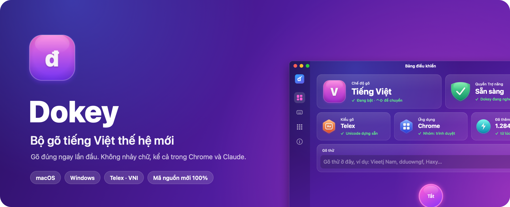
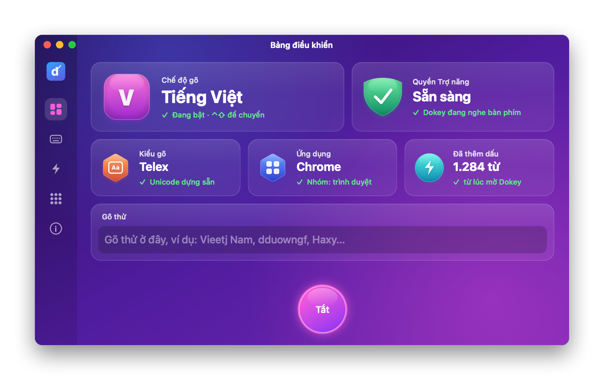
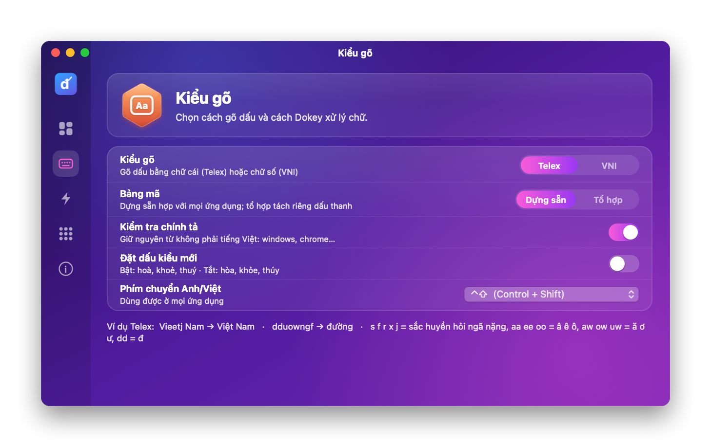
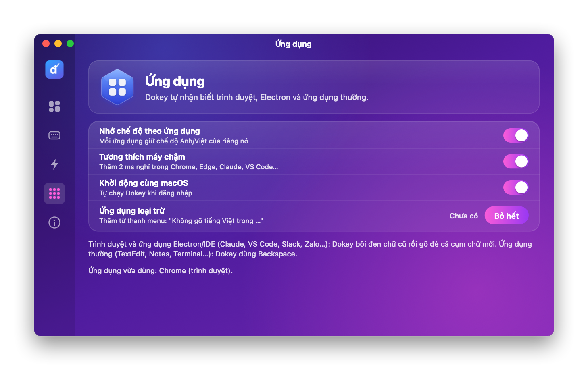
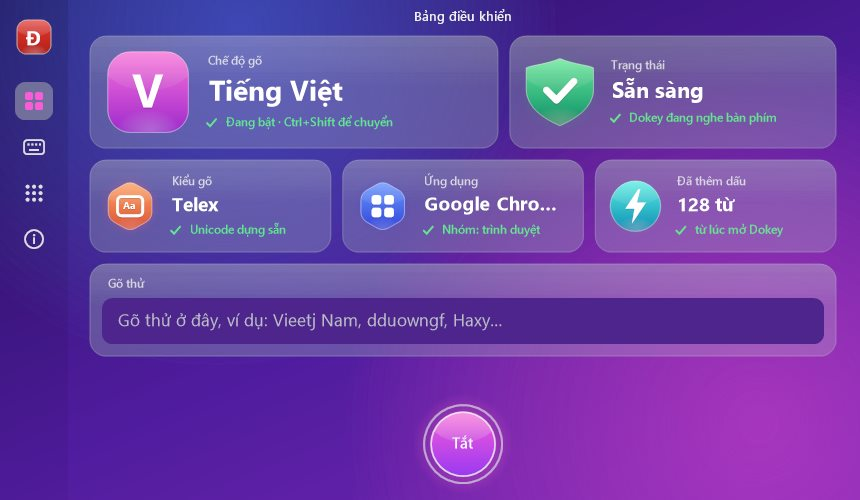
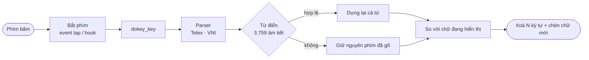

<div align="center">



<br>

[](https://github.com/dhtoan/Dokey/actions/workflows/ci.yml)
[](https://github.com/dhtoan/Dokey/releases/latest)


[](LICENSE)
[](#-đồng-hành-cùng-dokey)

# Dokey: bộ gõ tiếng Việt cho Mac và Windows

### Gõ đúng ngay lần đầu. Không nhảy chữ, không mất chữ, ở mọi ứng dụng.

[](README.md)
[](README.en.md)

[**⬇️ Tải cho macOS**](#-macos) &nbsp;·&nbsp; [**⬇️ Tải cho Windows**](#-windows) &nbsp;·&nbsp; [Tính năng](#-tính-năng) &nbsp;·&nbsp; [Nhà phát triển](#-dành-cho-nhà-phát-triển) &nbsp;·&nbsp; [Lộ trình](#-lộ-trình)

</div>

---

**Dokey** là bộ gõ tiếng Việt miễn phí cho **macOS** (Intel và Apple Silicon) và **Windows 10/11**, hỗ trợ **Telex** và **VNI**, viết lại hoàn toàn từ đầu. Mỗi phím bấm, Dokey dựng lại cả từ và kiểm tra với từ điển 3.759 âm tiết, nên chữ trên màn hình luôn khớp với những gì bạn gõ. Dokey không nhảy chữ, không mất chữ, kể cả trong Chrome, Edge, Claude hay các ứng dụng Electron.

<div align="center">

</div>

## 💡 Vì sao có Dokey?

Gõ tiếng Việt trên máy tính vẫn hay gặp những lỗi rất khó chịu: chữ nhảy lung tung trong Chrome, mất chữ trong ô chat của các ứng dụng Electron, từ tiếng Anh bị thêm dấu, và chữ trên màn hình lệch với những gì bộ gõ nghĩ. Dokey được viết lại từ con số 0 để giải quyết tận gốc các lỗi đó:

| Vấn đề thường gặp | Cách Dokey giải quyết |
|---|---|
| Nhảy chữ, lặp chữ khi gõ nhanh | Phím sửa chữ được chèn ngay tại vị trí bắt phím, luôn đi trước phím gõ tiếp theo |
| Mất chữ trong Claude, Notion, thanh địa chỉ | Bôi đen chữ cũ rồi gõ đè cả cụm; không dùng mã phím đang bị giữ |
| Chữ trên màn hình lệch với bộ gõ | Mỗi phím, cả từ được dựng lại từ chuỗi phím đã gõ bằng một hàm thuần |
| Từ tiếng Anh bị thêm dấu (`windows` → wíndows) | Kiểm tra với từ điển 3.759 âm tiết; không hợp lệ thì giữ nguyên phím đã gõ |
| Cài đặt bị macOS cảnh báo | Script cài đặt một dòng, không cảnh báo |

## ✨ Tính năng

<table>
<tr>
<td width="50%" valign="top">

**⚡ Không nhảy chữ, không mất chữ**<br>
Chỉ gửi phím khi thật sự phải sửa chữ. Trong trình duyệt và ứng dụng Electron, Dokey bôi đen chữ cũ rồi gõ đè cả cụm, nên gõ nhanh cũng không mất chữ.

</td>
<td width="50%" valign="top">

**📖 Hiểu chính tả tiếng Việt**<br>
Dấu chỉ được thêm khi kết quả là tiếng Việt hợp lệ. Các từ tiếng Anh như `windows`, `chrome`, `github` được giữ nguyên.

</td>
</tr>
<tr>
<td valign="top">

**✍️ Gõ dấu tự do**<br>
`tieengs`, `tienges`, `tiengse` đều ra **tiếng**; `dduocwj` và `dduowcj` đều ra **được**. Gõ lặp phím dấu để huỷ (`aaa` → aa).

</td>
<td valign="top">

**🎯 Đặt dấu chuẩn**<br>
Kiểu mới (hoà, khoẻ, thuý) hoặc kiểu cũ (hòa, khỏe, thúy). Hỗ trợ Telex, VNI, Unicode dựng sẵn và Unicode tổ hợp.

</td>
</tr>
<tr>
<td valign="top">

**🧠 Nhớ theo từng ứng dụng**<br>
Mỗi ứng dụng giữ chế độ Anh/Việt riêng, có danh sách ứng dụng loại trừ. Chuyển nhanh bằng ⌃⇧ trên Mac, Ctrl+Shift trên Windows.

</td>
<td valign="top">

**🪶 Nhẹ và riêng tư**<br>
Lõi C++17 không phụ thuộc thư viện ngoài. Không gửi dữ liệu đi đâu, không ghi lại phím gõ.

</td>
</tr>
<tr>
<td valign="top">

**⚡ Gõ nhanh**<br>
Gõ tắt (`vn` → Việt Nam), Quick Telex (`cc` → ch, `nn` → ng), hoàn tác bằng Esc (`tiếng` → tieesng).

</td>
<td valign="top">

**↩️ Sửa lại dễ dàng**<br>
Gõ xong từ và dấu cách, bấm Backspace để quay lại sửa dấu. Xoá phụ âm cuối thì dấu thanh tự về đúng chỗ.

</td>
</tr>
</table>

| Kiểu gõ | Ví dụ |
|---|---|
| **Telex** | `dduowngf` → đường · `nguoiwf` → người · `Haxy` → Hãy · `quyeets` → quyết · `DDawks Lawks` → Đắk Lắk |
| **VNI** | `d9u7o7ng2` → đường · `Vie65t` → Việt |

## 🍎 macOS

<table>
<tr>
<td width="50%"></td>
<td width="50%"></td>
</tr>
</table>

**Cài đặt.** Mở Terminal và chạy lệnh sau. Script tải bản mới nhất, cài vào Applications và không bị macOS cảnh báo:

```bash
gh release download -R dhtoan/Dokey --pattern install-macos.sh --dir /tmp --clobber && bash /tmp/install-macos.sh
```

Sau đó bật Dokey trong **System Settings › Privacy & Security › Accessibility**. Bạn cũng có thể tải `Dokey-<phiên bản>.dmg` ở trang [Releases](https://github.com/dhtoan/Dokey/releases/latest).

- Một tệp Universal: Intel từ macOS 10.13, Apple Silicon từ macOS 11.
- Biểu tượng **V/E** trên thanh menu. Bấm vào Dokey.app để mở bảng điều khiển, có ô **Gõ thử** ngay bên trong.
- Tự nhận biết trình duyệt, ứng dụng Electron/IDE và ứng dụng thường để chọn cách gửi phím phù hợp. Có chế độ **Tương thích máy chậm**.
- Build bằng Command Line Tools, không cần Xcode: `apps/macos/build.sh --dmg`.

<details>
<summary><b>Cập nhật và gỡ cài đặt</b></summary>

**Cập nhật:** chạy lại lệnh cài đặt ở trên, rồi cấp lại quyền Trợ năng (xoá Dokey khỏi danh sách và thêm lại). Mỗi bản phát hành có chữ ký riêng nên macOS coi là ứng dụng mới.

**Gỡ cài đặt:**

```bash
osascript -e 'tell application id "com.dhtoan.dokey.mac" to quit'
rm -rf /Applications/Dokey.app
defaults delete com.dhtoan.dokey.mac
rm -f ~/Library/LaunchAgents/com.dhtoan.dokey.mac.launcher.plist ~/Library/Logs/Dokey*.log
```

Sau đó xoá Dokey khỏi **System Settings › Privacy & Security › Accessibility**.

</details>

Chi tiết: [apps/macos/README.md](apps/macos/README.md) · Đã kiểm thử những gì: [docs/TESTING.md](docs/TESTING.md).

## 🪟 Windows

<div align="center">

</div>

Cùng một giao diện trên Windows 10/11, vẽ bằng GDI+. Tải bộ cài `Dokey-<phiên bản>-Windows-Setup.exe` ở trang [Releases](https://github.com/dhtoan/Dokey/releases/latest).

<details>
<summary><b>Dokey cho Windows 10/11</b>: bộ cài <code>Dokey-&lt;phiên bản&gt;-Windows-Setup.exe</code> cho x86, x64 và ARM64</summary>

> ⚠️ **Chưa được thử trên máy Windows thật.** Dokey cho Windows được viết trên macOS. Mọi kiểm thử dưới đây chạy trên máy ảo GitHub Actions (Windows Server 2022, x64). Bản x86 và ARM64 mới chỉ được build, chưa chạy lần nào.

**Dokey 0.3** thêm ứng dụng cho Windows 10/11, một bộ cài cho cả x86, x64 và ARM64: `Dokey-<phiên bản>-Windows-Setup.exe`.

- Biểu tượng **V/E** ở khay hệ thống; chuyển Anh/Việt bằng Ctrl+Shift hoặc Alt+Z, hoặc bấm vào biểu tượng.
- Telex/VNI, kiểm tra chính tả, đặt dấu kiểu mới/cũ, khởi động cùng Windows.
- **Chống nhảy chữ:** hook `WH_KEYBOARD_LL` nhẹ trên luồng riêng; mỗi lần sửa chữ là một lần `SendInput` duy nhất (xoá + chèn Unicode); phím gõ tiếp trong lúc chờ được xếp hàng sau chữ của Dokey nên không vượt lên trước được. Với Chrome, Edge và ứng dụng Electron (`Chrome_WidgetWin_*`) có thêm khoảng nghỉ ngắn giữa phím xoá và chữ mới.
- Tự đứng ngoài khi bộ gõ Trung/Nhật/Hàn đang bật; đặt lại từ khi click chuột, đổi cửa sổ, bấm phím mũi tên.
- Không cần quyền quản trị, không cần cài Visual C++ Redistributable.

### Đã kiểm thử đến đâu

| Hạng mục | Trạng thái |
|---|---|
| Build `Dokey.exe` cho x86, x64, ARM64 (MSVC, CRT tĩnh) và kiểm tra kiến trúc từng tệp | ✅ Mỗi lần CI |
| Unit test: dựng chuỗi sự kiện `SendInput`, gắn `dwExtraInfo`, hợp đồng với engine | ✅ CI, x64 và x86 |
| `Dokey.exe --self-test`: cài và gỡ hook bàn phím/chuột | ✅ CI, x64 và x86 |
| **Gõ thật vào Notepad**: phím giả lập bằng `SendInput`, gõ thường (40 ms/phím) và gõ dồn hết tốc độ, đọc lại chữ trong Notepad: `Việt Nam đường windows Tôi yêu tiếng Việt` | ✅ CI, x64 (máy ảo) |
| Bộ cài: cài im lặng, chọn đúng bản x64, có lối tắt Start menu, gỡ cài đặt sạch | ✅ CI, x64 (máy ảo) |
| Gõ trong Chrome, Edge, VS Code, Word… | ❌ Chưa kiểm thử |
| Máy thật Windows 10/11, máy chậm, máy ARM64, bản x86 trên Windows 32-bit | ❌ Chưa kiểm thử |
| Giao diện khay, menu, phím tắt chuyển Anh/Việt, khởi động cùng Windows | ❌ Chưa kiểm thử bằng tay |

Bộ cài chưa ký số nên SmartScreen có thể cảnh báo: chọn **More info → Run anyway**. Chi tiết: [apps/windows/README.md](apps/windows/README.md).

</details>

## ❓ Câu hỏi thường gặp

<details>
<summary><b>Bộ gõ tiếng Việt nào tốt cho Mac?</b></summary>

Dokey là bộ gõ tiếng Việt miễn phí cho macOS 10.13 trở lên, chạy trên cả Intel và Apple Silicon. Dokey hỗ trợ Telex, VNI, kiểm tra chính tả, giữ nguyên từ tiếng Anh, và được thiết kế để không nhảy chữ trong Chrome, Edge, Safari, ChatGPT, Claude, Notion và VS Code.

</details>

<details>
<summary><b>Vì sao gõ tiếng Việt trên Chrome hay bị nhảy chữ?</b></summary>

Chrome và các ứng dụng Electron xử lý phím ở một tiến trình riêng, nên phím xoá và chữ mới có thể đến lệch thứ tự hoặc bị bỏ qua. Dokey chèn phím sửa ngay tại vị trí bắt phím, bôi đen chữ cũ rồi gõ đè cả cụm trong một lần, và không dùng mã phím của phím bạn đang giữ.

</details>

<details>
<summary><b>Gõ tiếng Việt trong ChatGPT, Claude bị mất chữ (Hãy thành Hy)?</b></summary>

Đây là lỗi thường gặp với các ô soạn thảo kiểu ProseMirror. Dokey 0.3.2 trở lên đã sửa lỗi này: cài Dokey và cấp quyền Trợ năng là gõ được bình thường.

</details>

<details>
<summary><b>Dokey có miễn phí không? Có dùng mã của Unikey hay OpenKey không?</b></summary>

Dokey miễn phí cho người dùng cá nhân, không quảng cáo, không có bản trả phí. Dokey được viết mới hoàn toàn với lõi Dokey Core (C++17) và không chứa mã của bộ gõ nào khác.

</details>

<details>
<summary><b>Đã cài nhưng gõ không ra dấu?</b></summary>

Dokey cần quyền **Trợ năng**. Mở **System Settings › Privacy & Security › Accessibility**, xoá Dokey (−), thêm lại `/Applications/Dokey.app` (+) rồi bật công tắc. Sau mỗi lần cập nhật đều phải làm lại bước này. Bảng điều khiển có thẻ **Quyền Trợ năng** cho biết Dokey đã sẵn sàng chưa.

</details>

<details>
<summary><b>Trong ô mật khẩu hoặc Terminal "Secure Keyboard Entry" không gõ được dấu?</b></summary>

Khi một ứng dụng bật Secure Input (ô mật khẩu, tuỳ chọn Secure Keyboard Entry của Terminal), macOS không cho bất kỳ bộ gõ nào đọc phím. Đây là cơ chế bảo mật của hệ điều hành.

</details>

<details>
<summary><b>Gõ nhanh trên máy cũ vẫn thỉnh thoảng sai chữ?</b></summary>

Mở bảng điều khiển, vào trang **Ứng dụng**, bật **Tương thích máy chậm**. Nếu vẫn còn lỗi, hãy báo kèm tên ứng dụng và chuỗi phím đã gõ (ví dụ `Haxy` → `Hy`).

</details>

<details>
<summary><b>Muốn tắt tiếng Việt cho một ứng dụng?</b></summary>

Bật **Nhớ chế độ theo ứng dụng** (mặc định đang bật), mở ứng dụng đó và bấm ⌃⇧ để chuyển sang tiếng Anh. Lần sau mở lại, ứng dụng đó tự ở chế độ tiếng Anh.

</details>

## 🔒 Quyền riêng tư

Dokey chạy hoàn toàn trên máy của bạn. Dokey không kết nối mạng, không thu thập dữ liệu và không lưu lại phím gõ. Nhật ký gỡ lỗi mặc định tắt; chỉ khi bạn tự bật nó thì Dokey mới ghi vào `~/Library/Logs/Dokey.log` trên máy.

## 🛠 Dành cho nhà phát triển

Dokey Core là thư viện C++17 độc lập, có API C ổn định để tích hợp vào Swift, Win32 hay Kotlin.

```console
$ dokey "Xin chaof cacs banj, Dokey gox tieengs Vieetj khoong nhayr chuwx."
Xin chào các bạn, Dokey gõ tiếng Việt không nhảy chữ.
```

<details>
<summary><b>Công cụ dòng lệnh, build và API C</b></summary>

```bash
dokey "Vieetj Nam"                 # Việt Nam
echo "chaof buooir sangs" | dokey  # chào buổi sáng
dokey --vni "Vie65t Nam"           # Việt Nam
dokey --old-tone "hoaf binhf"      # hòa bình
```

Build từ mã nguồn (CMake 3.16+, trình biên dịch C++17):

```bash
cmake -S . -B build -DCMAKE_BUILD_TYPE=Release
cmake --build build --config Release
ctest --test-dir build -C Release
```

Tích hợp: chuyển từng phím cho engine, rồi thực hiện phép sửa mà engine trả về.

```c
#include <dokey/dokey.h>

dokey_options opt = { DOKEY_TELEX, DOKEY_UNICODE, /*modern*/ 1, /*spell*/ 1 };
dokey_engine* engine = dokey_create(&opt);

dokey_edit edit;
if (dokey_key(engine, typedChar, &edit)) {
    // Nuốt phím gốc, xoá edit.backspaces ký tự, rồi chèn edit.text (UTF-16).
} else {
    // Để phím gốc đi qua.
}
dokey_backspace(engine);  // khi người dùng bấm Backspace
dokey_reset(engine);      // khi click chuột, đổi ứng dụng, bấm phím mũi tên
dokey_destroy(engine);
```

</details>

### Kiến trúc



```
Dokey/
├── include/dokey/        API công khai: dokey.h (C), engine.hpp (C++)
├── src/                  Lõi: parser Telex/VNI, đặt dấu, từ điển âm tiết, Unicode
├── tools/                Công cụ dòng lệnh dokey
├── tests/                20.635 ca kiểm thử lõi, dữ liệu từ thật trong tests/data
├── apps/
│   ├── macos/            Swift + AppKit: event tap, bảng điều khiển, build.sh, install.sh
│   └── windows/          C++ Win32 + GDI+: hook bàn phím, bảng điều khiển, bộ cài Inno Setup
├── docs/                 Hình ảnh, kết quả kiểm thử
└── .github/              CI, quy trình phát hành, ghi chú phát hành
```

| Thư mục | Nội dung |
|---|---|
| `include/dokey/` | API công khai: C (`dokey.h`) và C++ (`engine.hpp`) |
| `src/` | Parser, quy tắc đặt dấu, từ điển âm tiết, bảng ký tự Unicode |
| `tools/` · `tests/` | Công cụ dòng lệnh `dokey` · 20.635 ca kiểm thử |
| `apps/macos/` | Ứng dụng macOS (Swift + AppKit), script build và cài đặt |
| `apps/windows/` | Ứng dụng Windows (C++ Win32), bộ cài Inno Setup |
| `SPEC.md` · `docs/` | Đặc tả hành vi · kết quả kiểm thử, hình ảnh |

**Chất lượng:** 20.635 ca kiểm thử chạy trên Linux, macOS và Windows sau mỗi lần thay đổi:
- phép thử khứ hồi: gõ toàn bộ 3.964 âm tiết với cả 6 thanh;
- bộ kiểm thử hồi quy gồm 1.171 từ tiếng Anh và từ lập trình (phải giữ nguyên) và 30 câu tiếng Việt thật gõ Telex. Mã biên dịch không có cảnh báo với `-Wall -Wextra -Wpedantic`.

## 🗺 Lộ trình

| Phiên bản | Nội dung | Trạng thái |
|---|---|---|
| **0.1** | Dokey Core: Telex, VNI, kiểm tra chính tả, API C/C++, công cụ dòng lệnh | ✅ |
| **0.2** | Ứng dụng macOS (Swift + AppKit, Intel và Apple Silicon) | ✅ |
| **0.3** | Ứng dụng Windows; sửa mất chữ trong Claude và trình duyệt; bảng điều khiển mới; cài không cảnh báo | ✅ |
| **0.4** | Gõ tắt, Quick Telex, hoàn tác bằng Esc, mở lại từ, loại trừ ứng dụng, Google Docs, Spotlight, kiểm tra cập nhật | ✅ |
| 0.5 | Công cụ chuyển mã, bảng mã TCVN3, VNI Windows, CP1258; gõ nhanh trên Windows | 🗓️ |
| 1.0 | Ký số và notarize, phát hành chính thức | 🗓️ |

Các thay đổi theo từng phiên bản: [Releases](https://github.com/dhtoan/Dokey/releases).

## ☕ Đồng hành cùng Dokey

Dokey **miễn phí** cho người dùng cá nhân, và sẽ luôn như vậy. Dokey không có quảng cáo, không thu thập dữ liệu và không có bản trả phí.

Còn một việc Dokey chưa làm được một mình: **chữ ký số của Apple**. Tài khoản Apple Developer có phí **99 USD mỗi năm (khoảng 2.600.000 đ)**. Khi có tài khoản này:

- ✅ Mở file `.dmg` là cài được, **không còn cảnh báo** "không xác định được nhà phát triển", không cần lệnh Terminal.
- ✅ **Không phải cấp lại quyền Trợ năng sau mỗi lần cập nhật**, vì chữ ký cố định nên macOS nhớ quyền.
- ✅ Tự cập nhật một chạm cho mọi người, không cần GitHub CLI.
- ✅ Mở đường cho một phiên bản Dokey trên Mac App Store.


Nếu Dokey giúp bạn gõ tiếng Việt dễ chịu hơn mỗi ngày, mời tác giả một ly cà phê nhé. Mọi khoản đều được dùng đúng cho mục tiêu trên. Phần dư (nếu có) dùng cho chứng chỉ ký số trên Windows, để bộ cài không còn bị SmartScreen cảnh báo.

<table>
<tr>
<td align="center" width="50%">
<br>
<b>Chuyển khoản ngân hàng</b><br>
Quét bằng app ngân hàng bất kỳ<br>
Techcombank · App Dokey · nội dung sẵn <code>dokey</code>
</td>
<td align="center" width="50%">
<br>
<b>Ví MoMo</b><br>
Quét bằng app MoMo hoặc app ngân hàng<br>
Ghi nội dung <code>dokey</code> để Dokey biết bạn ủng hộ
</td>
</tr>
</table>

**Gợi ý cho vui:**

| | |
|---|---|
| 🧋 20.000 đ | Một ly trà đá cho người viết bộ gõ |
| ☕ 50.000 đ | Một ly cà phê sữa đá, đủ sửa một lỗi nhảy chữ |
| 🍜 100.000 đ | Một tô phở, đủ cho một tính năng mới |
| 🍎 2.600.000 đ | Trọn một năm chữ ký Apple cho tất cả mọi người |

Muốn được ghi tên trong mục **Những người đồng hành** bên dưới? Ghi thêm tên bạn vào nội dung chuyển khoản (ví dụ `dokey Minh Anh`). Không ghi thì Dokey hiểu là bạn muốn ẩn danh.

**Chưa tiện tài trợ?** Không sao cả. Một ⭐ cho repo, giới thiệu Dokey với bạn bè, hay báo một lỗi gõ sai cũng là đồng hành rất quý.

### 💛 Những người đồng hành

*Chưa có ai cả. Hãy là người đầu tiên!*

## ⚖️ Giấy phép

Dokey là **phần mềm độc quyền**. © 2026 Do Huy Toan ([dhtoan](https://github.com/dhtoan)). All rights reserved.

Bạn được cài và dùng các bản phát hành chính thức cho mục đích cá nhân. **Cấm** sao chép, sửa đổi, phân phối lại, dịch ngược hoặc dùng mã nguồn để làm sản phẩm khác khi chưa có văn bản cho phép của tác giả. Toàn văn: [LICENSE](LICENSE).

Dokey được viết mới hoàn toàn và không chứa mã của bộ gõ nào khác.

---

<div align="center">

© 2026 Do Huy Toan (dhtoan). All rights reserved.

</div>
