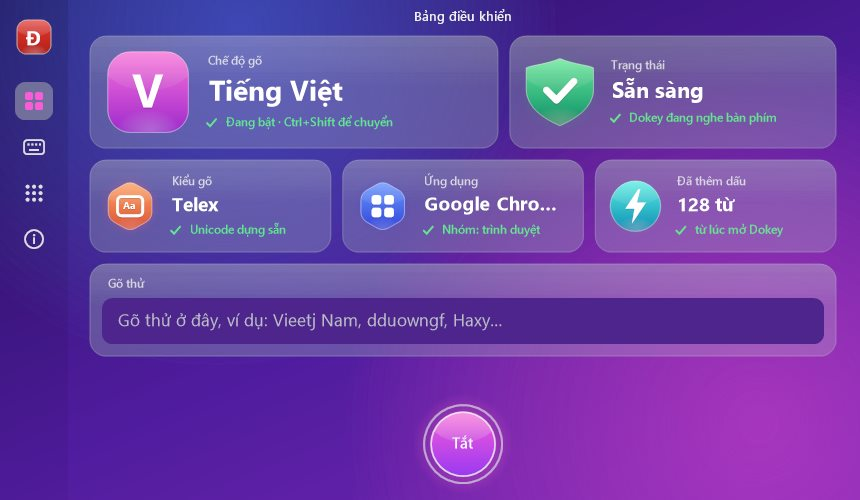

# Dokey cho Windows

> ⚠️ **Chưa được thử trên máy Windows thật.** Ứng dụng được viết trên macOS và chỉ được build, chạy unit test, self-test và thử cài/gỡ trên máy ảo GitHub Actions (`windows-2022`). Hãy thử kỹ trước khi dùng hằng ngày và báo lỗi tại Issues.

Bộ gõ tiếng Việt cho Windows 10/11 (x86, x64, ARM64), viết bằng C++ Win32, dùng lõi [Dokey Core](../../README.md) qua C API `include/dokey/dokey.h`.

## Cài đặt

Tải `Dokey-<phiên bản>-Windows-Setup.exe` ở trang [Releases](https://github.com/dhtoan/Dokey/releases) rồi chạy. Bộ cài:
- tự chọn bản x86, x64 hoặc ARM64 hợp với máy;
- mặc định cài cho người dùng hiện tại (không cần quyền quản trị), có thể chọn cài cho mọi người dùng;
- tạo lối tắt trong Start menu, tuỳ chọn khởi động cùng Windows;
- có trình gỡ cài đặt (Settings → Apps, hoặc "Uninstall Dokey" trong Start menu).

Bộ cài chưa được ký số, nên Windows SmartScreen có thể cảnh báo: bấm **More info → Run anyway**.

## Sử dụng



- **Bảng điều khiển** mở ra khi chạy Dokey (Start menu, biểu tượng ngoài màn hình), kể cả khi Dokey đang chạy sẵn, hoặc từ mục "Mở bảng điều khiển" trong menu khay. Có các trang: tổng quan (chế độ gõ, trạng thái, kiểu gõ, ứng dụng đang dùng, số từ đã thêm dấu, ô gõ thử, nút Bật/Tắt), kiểu gõ, gõ nhanh, ứng dụng và giới thiệu. Khi khởi động cùng Windows, Dokey chạy ngầm ở khay (`--background`), không mở bảng.
- Biểu tượng **V** (đỏ) / **E** (xám) ở khay hệ thống: bấm chuột trái để chuyển Việt/Anh, chuột phải để mở menu.
- Phím tắt chuyển Việt/Anh: **Ctrl+Shift** (bấm rồi thả) hoặc **Alt+Z**, chọn trong menu.
- Menu: kiểu gõ Telex/VNI, kiểm tra chính tả, dấu kiểu mới (hoà, khoẻ) hay kiểu cũ (hòa, khỏe), khởi động cùng Windows.
- **Gõ nhanh** (trang riêng trong bảng điều khiển):
  - *Gõ tắt*: mỗi dòng `từ tắt = nội dung`, sửa ngay trong bảng; gõ từ tắt rồi dấu cách để thay (`btw` → by the way, `Btw` → By the way, `BTW` → BY THE WAY). Bật sẵn với vài từ mẫu.
  - *Quick Telex* (mặc định tắt): ở đầu từ, `cc gg kk nn pp qq tt` → `ch gi kh ng ph qu th`.
  - *Hoàn tác bằng Esc* (mặc định tắt): trả từ đang gõ về đúng các phím đã gõ (tiếng → tieesng).
- **Backspace thông minh:** gõ xong một từ và một dấu cách, bấm Backspace là quay lại sửa dấu từ đó (`xin` ␣ ⌫ `f` → xìn); xoá chữ làm dấu thanh đổi chỗ thì dấu tự về đúng vị trí.
- **Ứng dụng loại trừ:** luôn gõ tiếng Anh trong các ứng dụng chọn ở trang Ứng dụng hoặc mục "Không gõ tiếng Việt trong …" của menu khay. Bấm phím chuyển trong ứng dụng đó để bỏ loại trừ.
- **Tiếng Hàn (한국어, 두벌식):** chọn ngôn ngữ ở trang Kiểu gõ hoặc trong menu khay. Dokey đọc chữ cái theo vị trí phím (mã phím ảo), nên giữ bố cục English (US) và không cần bật bộ gõ tiếng Hàn của Microsoft: `dkssudgktpdy` → 안녕하세요, `gksrnr` → 한국. Chữ hiện ra ngay, không có chữ đang ghép dở. Ctrl+Shift, Alt+Z hoặc phím 한/영 để chuyển Anh/Hàn. Biểu tượng khay là **한**.
- **Giao diện tiếng Hàn:** khi ngôn ngữ hiển thị của Windows là tiếng Hàn, bảng điều khiển và menu khay hiện bằng tiếng Hàn, và ngôn ngữ gõ mặc định là tiếng Hàn. Bản dịch chưa được người Hàn duyệt.
- Cài đặt lưu ở `HKCU\Software\Dokey`.

## Cách hoạt động

| | |
|---|---|
| Bắt phím | `WH_KEYBOARD_LL` trên một luồng riêng. Hook chỉ chạy engine rồi xếp việc vào hàng đợi, không bao giờ chờ, để Windows không gỡ hook. |
| Gửi chữ | Khi `dokey_key` trả 1: xoá và chèn chữ (`KEYEVENTF_UNICODE`) bằng **một lần `SendInput`** trên luồng gửi. Khi trả 0: phím gốc đi qua. |
| Không nhảy chữ | Mỗi sự kiện Dokey gửi đều gắn `dwExtraInfo`. Từ lúc xếp việc tới lúc hook thấy sự kiện cuối của nó quay về, các phím người dùng gõ tiếp được xếp sau, nên không thể vượt lên trước chữ của Dokey. |
| Chrome, Edge, Electron | Nhận ra cửa sổ lớp `Chrome_WidgetWin_*` và nghỉ ngắn (mặc định 12 ms, `ChromiumPauseMs` trong registry) giữa phím xoá và chữ mới. |
| Google Docs, Sheets, Slides | Nhận ra qua tiêu đề cửa sổ (tiếng Anh hoặc tiếng Việt): gửi từng phím một, nghỉ 2 ms giữa các phím và 6 ms trước chữ mới (gấp đôi khi bật Tương thích máy chậm). |
| Đặt lại từ | Khi click chuột, đổi cửa sổ, phím mũi tên/Home/End/Delete/Esc, phím tắt Ctrl/Alt/Win. |
| Bộ gõ khác | Nếu bộ gõ Trung/Nhật/Hàn (hoặc Telex của Microsoft) đang bật, Dokey tạm đứng ngoài. Trạng thái được hỏi bằng `SendMessageTimeout` trên luồng giao diện và lưu tạm. |
| Bàn phím | Ký tự được lấy theo bố cục bàn phím của cửa sổ đang gõ (`ToUnicodeEx`), nên bố cục không phải Latin sẽ không bị biến đổi. |

Giới hạn đã biết:
- Không gõ được vào cửa sổ chạy quyền Administrator khi Dokey chạy quyền thường (Windows chặn, UIPI).
- Thanh địa chỉ Chrome có gợi ý tự hoàn thành có thể vẫn lệch; cần thử trên máy thật.

## Build

Cần Visual Studio 2022 (có công cụ ARM64 nếu build ARM64) và CMake 3.16+.

```bat
cmake -S apps/windows -B build/x64 -A x64
cmake --build build/x64 --config Release
ctest --test-dir build/x64 -C Release
```

Thay `-A x64` bằng `-A Win32` hoặc `-A ARM64` cho kiến trúc khác. Bộ cài: `iscc /DAppVersion=0.1.0 /DBinDir=<thư mục có x86\, x64\, arm64\> apps\windows\installer\Dokey.iss`.

CI ([`windows-app.yml`](../../.github/workflows/windows-app.yml)) build cả ba kiến trúc, chạy unit test, `Dokey.exe --self-test` (cài và gỡ hook), thử gõ vào Notepad, đóng gói bộ cài rồi thử cài/gỡ im lặng.

Biểu tượng ứng dụng được vẽ bằng [`tools/make_icon.py`](tools/make_icon.py); biểu tượng V/E ở khay và cả bảng điều khiển (GDI+, theo DPI của màn hình) được vẽ lúc chạy. `Dokey.exe --render-panel <tiền tố>` vẽ các trang của bảng ra file PNG; CI in ảnh vào log để kiểm tra.

© 2026 Do Huy Toan. All rights reserved. Phần mềm độc quyền, cấm sao chép, sửa đổi hay phân phối lại; xem [LICENSE](../../LICENSE).
